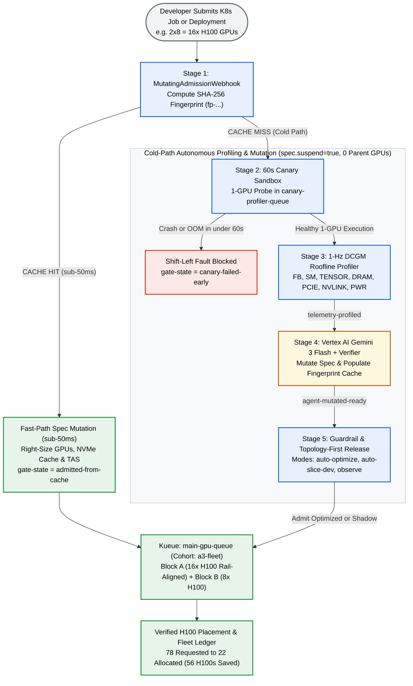

# Google Cloud Next '27 — Agent at the Gate (`next27-gpu-gatekeeper`)

> **Zero-Code Pre-Submission & Admission-Time GPU Optimization on GKE**  
> Maximizing GPU goodput and eliminating idle accelerator spend **before** full-scale multi-GPU gangs allocate cluster capacity—powered by **Kueue**, a **60-Second 1-GPU Canary Sandbox**, **1-Hz NVIDIA DCGM Roofline Telemetry**, **Live Vertex AI Gemini (`gemini-3-flash-preview`) Spec Mutation**, and **Progressive Enterprise Guardrail Modes**.

---

## 1. Concept & Scope Boundary (Google Cloud Next '27)

### Why "Agent at the Gate"?
1. **Developers guess GPU specs blindly**: A fine-tuning or inference job submitted with `2 × 8 = 16` H100 GPUs can easily consume `<1 GiB` of VRAM and `0.0%` Tensor Core utilization while burning 16 H100s for hours—or crash immediately on a CUDA Out-Of-Memory (`OOM`) / XID software fault after disrupting gang scheduling.
2. **`nvidia-smi` `utilization.gpu` (`DCGM_FI_DEV_GPU_UTIL`) is a vanity metric**: As documented in **Rafay**, **Mirantis**, and **NVIDIA GPU Gems 2 (Ch. 35)**, `GPU_UTIL` only measures whether *at least one warp* was active anywhere on the GPU during a sample interval. A workload can report **`100%` `GPU_UTIL`** while **0.0% of Tensor Cores** are active because warps are stalled waiting on HBM3 memory bandwidth or PCIe host I/O.
3. **Zero-code infrastructure shaping beats manual code rewrite**: Rather than nagging ML engineers to rewrite PyTorch kernels before running, an admission-time agent automatically right-sizes GPU counts / slices (`MIG`, Fractional vGPU, MPS/time-slicing), recommends cross-generation GKE `ComputeClass` routing (`G4`, `A3`, `A4`, `A4X`, `A5X`), attaches Local NVMe SSD scratch caching for I/O-stalled jobs, and enforces physical NVLink/rail placement (`cloud.google.com/gce-topology-block`) for true compute-saturated gangs.

### Strict Non-Overlap Boundary
* **This Session (*"Agent at the Gate"*)**: Strictly owns **Day-0 / Day-1 (before & during workload submission)**—intercepting workloads at Kubernetes/Kueue admission, micro-profiling unknown fingerprints on 1 GPU for up to 60 seconds, classifying hardware Roofline bottlenecks, and mutating pod/topology specs **before** full-scale admission.

---

## 2. End-to-End 5-Stage Architecture & State Machine



### Workload State Machine (`gpu-gatekeeper.cloud.google.com/gate-state`)

| `gate-state` Label | Set By | `spec.suspend` | GPUs Active | Meaning |
| :--- | :---: | :---: | :---: | :--- |
| `admitted-from-cache` | Stage 1 Webhook | Managed by Kueue | Mutated optimal count | Known `fp-*` hit in `ConfigMap/workload-fingerprint-cache`; mutated in `<50ms` (GPUs + NVMe volume + TAS + `ComputeClass`) and routed directly to `main-gpu-queue`. |
| `held-pending-canary` | Stage 1 Webhook | `true` | `0` | Unknown `fp-*`; `kueue.x-k8s.io/queue-name` stripped (saved in `target-queue` annotation) so Kueue allocates zero GPUs. |
| `canary-running` | Stage 2 Controller | `true` (parent) | `1` (canary probe) | `canary-<fp>` Job running in `canary-profiler-queue`; Stage 3 actively scraping `:9400/metrics` at `1 Hz`. |
| `canary-failed-early` | Stage 2 Controller | `true` | `0` | 1-GPU Canary crashed (`exitCode != 0`, e.g., CUDA OOM or XID 13/31); parent multi-GPU gang permanently blocked from wasting cluster quota. |
| `canary-completed` | Stage 2 Controller | `true` | `0` | 1-GPU Canary either completed cleanly (`exitCode=0`) or reached `60.0s` of live GPU runtime and was suspended cleanly. |
| `telemetry-profiled` | Stage 3 Profiler | `true` | `0` | 4-Signal Roofline profile computed (active-VRAM `FB_USED > 100 MiB` steady-state filter), saved to `ConfigMap/canary-telemetry-profiles` and Job annotation `dcgm-profile`. |
| `agent-mutated-ready` | Stage 4 Mutator | `true` | `0` | **Vertex AI `gemini-3-flash-preview`** + Safety Verifier mutated Job spec in-place (`parallelism`, `nvidia.com/gpu`, `/mnt/local-nvme-cache`, `podset-required-topology`) and populated `workload-fingerprint-cache`. |
| `admitted-optimized` | Stage 5 Controller | Managed by Kueue | Mutated optimal count | Released in Topology-First order to `main-gpu-queue` with full Stage 4 optimizations enforced; physical H100 node & `gce-topology-block` placement verified. |
| `admitted-observe-only` | Stage 5 Controller | Managed by Kueue | Original requested count | **Shadow / Audit Mode (`observe`)**: Preserves Gemini recommendation & would-save GPU metrics in ledger/annotations, restores user's original GPU spec, and admits unmodified. |

---

## 3. Repository Layout (`/usr/local/google/home/arunsinghh/next27-gpu-gatekeeper`)

All directories are restricted to `0700` and all files to `0600` (`arunsinghh` owner-only):

```text
next27-gpu-gatekeeper/
├── README.md                              # Complete architecture, runbook & live H100 + Gemini + Kueue results
├── stage1/                                # ✅ Stage 1: Interception & Hold ("The Gate")
│   ├── 01-kueue-config.yaml               # Namespace ml-workloads, Topology a3-rail-topology, Cohort & Dual Queues
│   ├── 02-gatekeeper-webhook.yaml         # TLS 1.2+ MutatingAdmissionWebhook + ConfigMap workload-fingerprint-cache
│   ├── webhook_server.py                  # Python AdmissionReview server (Cold hold + <50ms Fast-Path GPU/NVMe/TAS mutation)
│   ├── profiles.json                      # Initial seeded smoke-test cache entry (fp-e80e3650301a)
│   ├── 03-bloated-lora-job.yaml           # Cold-Path workload: 2x8=16 H100s requested for tiny 1B LoRA loop
│   ├── 04-fastpath-smoke-job.yaml         # Fast-Path smoke workload: 1x8 H100s -> mutated to 1x1 H100 at admission
│   └── .certs/                            # Private self-signed CA & webhook TLS keypair (0600)
├── stage2/                                # ✅ Stage 2: 60-Second Canary Sandbox Controller
│   ├── 01-canary-controller.yaml          # ServiceAccount, RBAC, ConfigMap & Deployment gpu-gatekeeper-canary-controller
│   ├── canary_controller.py               # 1-GPU probe cloner, image-pull exclusion timer, 60s cutoff & crash guard
│   └── 02-broken-oom-job.yaml             # Shift-Left fault test: 2x8=16 H100 job allocating 96 GB -> caught in 2.0s
├── stage3/                                # ✅ Stage 3: Deep 4-Signal DCGM Hardware Telemetry Profiler
│   ├── 01-telemetry-profiler.yaml         # ServiceAccount, RBAC, ConfigMap canary-telemetry-profiles & Deployment
│   ├── telemetry_profiler.py              # 1-Hz dcgm-exporter (:9400) scraper, active-VRAM filter & Roofline classifier
│   ├── 02-mem-bw-bound-job.yaml           # Roofline test: 33 GiB FP16 KV-cache HBM3 streaming (1x4=4 H100s requested)
│   ├── 03-tensor-saturated-job.yaml       # Roofline test: 16384x16384 FP16 GEMM Tensor-Core saturation (2x8=16 H100s)
│   └── captured-h100-profiles.json        # Live 1-Hz H100 silicon profiles captured across all 3 Roofline regimes
├── stage4/                                # ✅ Stage 4: Agentic Reasoning & Zero-Code Spec Mutator
│   ├── 01-agentic-mutator.yaml            # Workload Identity SA, RBAC, ConfigMap & Deployment gpu-gatekeeper-agentic-mutator
│   ├── agentic_mutator.py                 # Live Vertex AI Gemini 3 Flash caller, 4-rule Safety Verifier, cache & Job mutator
│   ├── 02-fastpath-retest-lora.yaml       # Duplicate submission (bloated-lora-finetune-run2) proving <50ms cache hit
│   └── captured-gemini-decisions.json     # Verbatim live Vertex AI gemini-3-flash-preview JSON decisions across all 3 jobs
├── stage5/                                # ✅ Stage 5: Full-Scale Admission, Guardrail Modes & Fleet Ledger
│   ├── 01-admission-controller.yaml       # RBAC, ConfigMaps (policy + ledger) & Deployment gpu-gatekeeper-admission-controller
│   ├── admission_controller.py            # Guardrail policy engine, Topology-First gang releaser & physical placement verifier
│   ├── 02-observe-mode-shadow-job.yaml    # Progressive trust test: policy-mode=observe (shadow recommendation + 2-GPU restore)
│   └── captured-admission-ledger.json     # Final verified cluster-wide ledger (78 requested -> 22 allocated = 56 H100s saved!)
└── references/
    └── Xid-Catalog.xlsx                   # NVIDIA XID hardware/software fault resolution catalog
```

---

## 4. Live Infrastructure & Physical Rail Topology

### Cluster, Control-Plane Isolation & Reservation Binding
* **GKE Cluster**: `arunsinghh-next27-gpu-gatekeeper` in `cool-machine-learning` (`asia-east1-c`), GKE `1.36.4-gke.2377000`, Managed Prometheus + Workload Identity (`cool-machine-learning.svc.id.goog`) enabled.
* **Control-Plane / Agent Node Pool (`default-pool`)**: `1 × e2-standard-8` (`gke-arunsinghh-next27-gp-default-pool-bbc006a0-c4gj`) running all **5 Gatekeeper microservices** (`1/1 Running`, `0` restarts, non-root UID `65532`, read-only rootfs) in namespace `gpu-gatekeeper`:
  1. `gpu-gatekeeper-webhook` (Stage 1)
  2. `gpu-gatekeeper-canary-controller` (Stage 2)
  3. `gpu-gatekeeper-telemetry-profiler` (Stage 3)
  4. `gpu-gatekeeper-agentic-mutator` (Stage 4)
  5. `gpu-gatekeeper-admission-controller` (Stage 5)
* **Reserved H100 Pool (`a3-h100-reserved-pool`)**: `3 × a3-highgpu-8g` (`24 × nvidia-h100-80gb`), provisioned with `--max-surge-upgrade=0`, `--gpu-driver-version=latest` (`580.178.04`), `--ephemeral-storage-local-ssd count=16` (`6 TB` raw NVMe scratch per host), and `--reservation-affinity=any-reservation-then-fail` strictly consuming all `3/3` VMs of open GCE reservation `res-a3-highgpu-8g-asia-east1-c`.

### Live Node Inventory & Physical Topology (`gce-topology-block`)

| Node Name | Pool | Machine Type | GPUs | `cloud.google.com/gce-topology-block` | `cloud.google.com/gce-topology-subblock` | `dcgm-exporter` Pod IP |
| :--- | :--- | :--- | :---: | :--- | :--- | :---: |
| `gke-arunsinghh-next2-a3-h100-reserved-d271d988-nwcz` | `a3-h100-reserved-pool` | `a3-highgpu-8g` | `8 × H100` | **`6527c77ee8f284cc1f0a7da650753414`** *(Block A)* | `7766c9c17e882d261cce3e590219202d` | `10.20.2.2:9400` |
| `gke-arunsinghh-next2-a3-h100-reserved-d271d988-v3mg` | `a3-h100-reserved-pool` | `a3-highgpu-8g` | `8 × H100` | **`6527c77ee8f284cc1f0a7da650753414`** *(Block A)* | `29c33a694b14fd8b103937f4198565f2` | `10.20.1.4:9400` |
| `gke-arunsinghh-next2-a3-h100-reserved-d271d988-8czc` | `a3-h100-reserved-pool` | `a3-highgpu-8g` | `8 × H100` | `eb7949fa00034cd0eceb4bce25085cb8` *(Block B)* | `0b42d88bb7b7f92f2495e090186bc5c8` | `10.20.3.4:9400` |
| `gke-arunsinghh-next27-gp-default-pool-bbc006a0-c4gj` | `default-pool` | `e2-standard-8` | `0` | — | — | — |

> **Cloudtop `kubectl` Auth Note:** Always prefix `kubectl` commands on Cloudtop with `CLOUDSDK_CONTAINER_USE_APPLICATION_DEFAULT_CREDENTIALS=false` so `gke-gcloud-auth-plugin` authenticates as the active `gcloud` cluster admin (`arun@robhilton.altostrat.com`) rather than ADC.

---

## 5. Stage 1 — Interception & Hold ("The Gate") ✅

* **Kueue `v0.20.6` Dual-Queue Cohort (`stage1/01-kueue-config.yaml`)**:
  * `Topology/a3-rail-topology`: `cloud.google.com/gce-topology-block` → `cloud.google.com/gce-topology-subblock` → `kubernetes.io/hostname`.
  * `canary-profiler-queue` (`8` nominal H100s, `0` borrow) + `main-gpu-queue` (`16` nominal + `8` borrow = up to `24` H100s inside `Cohort/a3-fleet`).
* **TLS 1.2+ MutatingAdmissionWebhook (`stage1/02-gatekeeper-webhook.yaml`, `stage1/webhook_server.py`)**:
  * Hashes `{kind, parallelism, gpus_per_pod, containers: [{image, command, args, tracked_env}]}` into SHA-256 `fp-<12hex>`.
  * **Fast Path (`CACHE_HIT`)**: Mutates GPU count, parallelism, `/mnt/local-nvme-cache` volume, `podset-required-topology`, and `recommended-compute-class` in `<50ms` (`gate-state=admitted-from-cache`).
  * **Cold Path (`CACHE_MISS`)**: Strips `kueue.x-k8s.io/queue-name`, sets `spec.suspend=true`, and holds at `gate-state=held-pending-canary` (`0` GPUs burned).

---

## 6. Stage 2 — The 60-Second Canary Sandbox Controller ✅

* **Controller (`stage2/01-canary-controller.yaml`, `stage2/canary_controller.py`)**:
  * Clones held `ml-workloads` Jobs into single-pod, **1-GPU** probes (`canary-<fingerprint>`) in `canary-profiler-queue`.
  * Excludes `ContainerCreating` image-pull latency from the `60s` GPU runtime window (`running.startedAt`).
  * **Verified Shift-Left Crash Guard (`broken-oom-launch`, `fp-d334437292f2`)**: Caught an unsharded `96 GB` allocation (`torch.OutOfMemoryError`) on `1` H100 in **`2.0s`** (`exitCode=1`) and marked the `2×8=16` GPU parent `gate-state=canary-failed-early`—saving **16 H100 GPUs** from gang-failing!

---

## 7. Stage 3 — Deep 4-Signal DCGM Hardware Telemetry Profiler ✅

* **Profiler (`stage3/01-telemetry-profiler.yaml`, `stage3/telemetry_profiler.py`)**:
  * Scrapes GKE's managed `gke-managed-system/dcgm-exporter` (`:9400/metrics`) at **1 Hz** per running Canary pod, filtering steady-state kernel execution via `DCGM_FI_DEV_FB_USED > 100 MiB`.
  * Captures 4 deep hardware signals (`FB_USED`, `PROF_SM_ACTIVE` + `PROF_PIPE_TENSOR_ACTIVE` vs. vanity `GPU_UTIL`, `PROF_DRAM_ACTIVE` HBM3 bandwidth, and `PCIE`/`NVLINK` + `POWER_USAGE`) and classifies workloads into physics-grounded Roofline regimes:

| Workload (`Fingerprint`) | Orig. GPU Req | Peak VRAM (`FB_USED`) | Vanity `GPU_UTIL` (Peak) | True `SM_ACTIVE` | Tensor `HMMA` (`PIPE_TENSOR_ACTIVE`) | HBM3 `DRAM_ACTIVE` (Peak / Est. BW) | Board Power (Peak / `700W` TDP) | Stage 3 Roofline Classification |
| :--- | :---: | :---: | :---: | :---: | :---: | :---: | :---: | :--- |
| **`bloated-lora-finetune`** (`fp-db1beed010de`) | `2×8 = 16` | **`678 MiB`** (`0.83%`) | `0%` | `0.01%` | **`0.00%`** | `0.0%` (`0 GB/s`) | `118.3 W` | **`SEVERE_OVERPROVISIONING_AND_HOST_STALLS`** |
| **`mem-bw-kvcache-decode`** (`fp-b10cd3fd218a`) | `1×4 = 4` | **`33,386 MiB`** (`40.93%`) | **`100%`** | `86.8%` peak / `11.6%` avg | **`0.00%`** | **`84.3%` p95** (`~1.66 TB/s` burst, `~912 GB/s` active) | `527.1 W` peak / `123.4 W` avg | **`MEMORY_BANDWIDTH_BOUND` / `IO_AND_DATALOADER_STARVED`** |
| **`tensor-saturated-pretrain`** (`fp-19278762b06c`) | `2×8 = 16` | **`2,674 MiB`** (`3.28%`) | **`100%`** | `77.1%` p95 / `48.0%` avg | **`76.1%` p95 / `47.4%` avg** | `13.2%` p95 / `5.1%` avg (`~171 GB/s`) | **`696.5 W`** | **`COMPUTE_TENSOR_SATURATED`** |

---

## 8. Stage 4 — Agentic Reasoning & Zero-Code Spec Mutator ✅

* **Mutator (`stage4/01-agentic-mutator.yaml`, `stage4/agentic_mutator.py`)**:
  * Uses GKE Workload Identity Federation (`roles/aiplatform.user` on `gpu-gatekeeper-mutator-sa`) to call **live Vertex AI `gemini-3-flash-preview`** (`responseSchema` JSON) + a **4-rule Deterministic Safety Verifier** (`1.35×` VRAM floor, Compute-Saturation preservation + `gce-topology-block` TAS injection, single-GPU gang collapse, `/mnt/local-nvme-cache` Local SSD mount).
  * Mutated all 3 held workloads (`36` H100s → `18` H100s = **`50.0%` reduction**), populated `ConfigMap/workload-fingerprint-cache`, and verified `<50ms` Fast-Path cache hit on `bloated-lora-finetune-run2` (`16 → 1` GPU + NVMe cache at admission, completed in `48s`).

---

## 9. Stage 5 — Full-Scale Admission, Guardrail Modes & Fleet Ledger ✅

### Architecture & Implementation (`stage5/01-admission-controller.yaml`, `stage5/admission_controller.py`)
1. **Progressive Enterprise Guardrail Policy (`ConfigMap/gatekeeper-guardrail-policy`)**:
   Platform teams can graduate namespaces or individual Jobs (`gpu-gatekeeper.cloud.google.com/policy-mode`) across three trust levels without changing application YAML:
   * **`observe` (Shadow / Audit-Only Mode)**: Runs the full Canary + 1-Hz DCGM + Gemini 3 Flash pipeline, logs `shadow-recommended-gpus` and `shadow-gpus-would-save` onto the Job and Fleet Ledger, **restores the user's original requested GPU count & pod spec**, and admits unmodified (`gate-state=admitted-observe-only`).
   * **`auto-slice-dev` (Conservative Mode)**: Enforces mutations only when `env=dev` or `gpu_savings_pct >= 75%`; admits lower-savings workloads in shadow mode.
   * **`auto-optimize` (Full Autonomous Mode — Active Default)**: Enforces Stage 4's right-sized GPUs, Local NVMe SSD cache volumes, and Kueue TAS rail-alignment constraints (`gate-state=admitted-optimized`).
2. **Topology-First / Gang-First Release Ordering**:
   * Sorts `agent-mutated-ready` Jobs by `(0 if required_topology else 1, -recommended_total_gpus)` before attaching `kueue.x-k8s.io/queue-name: main-gpu-queue`.
   * Releasing `tensor-saturated-pretrain` (`2 × 8 = 16` H100s, `podset-required-topology: cloud.google.com/gce-topology-block`) **2 seconds ahead** of 1-GPU jobs guarantees Kueue TAS locks all `16` H100s of **contiguous Block A (`nwcz` + `v3mg`)** first, while `bloated-lora-finetune` (`1` H100) and `mem-bw-kvcache-decode` (`1` H100) borrow `2` spare GPUs from `canary-profiler-cq` and bin-pack cleanly onto **Block B (`8czc`)**—executing all `18` H100s **simultaneously** with zero head-of-line blocking!
3. **Physical Placement Verification & Live Fleet Audit Ledger (`ConfigMap/gatekeeper-admission-ledger`)**:
   * Inspects scheduled Pod `nodeName`s against live Node `cloud.google.com/gce-topology-block` labels, stamps `scheduled-nodes` and `scheduled-topology-blocks` onto every Job, and maintains a real-time cluster-wide JSON audit ledger.

### Stage 5 Deployment & Verification Commands
```bash
# 1. Deploy Stage 5 Admission & Guardrail Controller (releases all 3 ready workloads concurrently!)
CLOUDSDK_CONTAINER_USE_APPLICATION_DEFAULT_CREDENTIALS=false kubectl apply -f stage5/01-admission-controller.yaml

# 2. Test Progressive Guardrail 'observe' (Shadow) mode on a 2-GPU evaluation job
CLOUDSDK_CONTAINER_USE_APPLICATION_DEFAULT_CREDENTIALS=false kubectl apply -f stage5/02-observe-mode-shadow-job.yaml

# 3. Inspect Stage 5 placement verification logs & live cluster-wide audit ledger
CLOUDSDK_CONTAINER_USE_APPLICATION_DEFAULT_CREDENTIALS=false kubectl logs deployment/gpu-gatekeeper-admission-controller -n gpu-gatekeeper --tail=30
CLOUDSDK_CONTAINER_USE_APPLICATION_DEFAULT_CREDENTIALS=false kubectl get configmap gatekeeper-admission-ledger -n gpu-gatekeeper -o jsonpath='{.data.ledger\.json}{"\n"}'
```

### Stage 5 Final Verified Live Cluster Ledger (`stage5/captured-admission-ledger.json`)
Across all **7** real workloads submitted to `ml-workloads`, Gatekeeper reduced enforced H100 consumption from **`78` H100 GPUs requested down to `22` H100 GPUs allocated**—saving **`56` H100 GPUs (`71.79%` fleet-wide reduction)** while completing every valid job with verified physical topology placement:

| Workload (`Job`) | Path / Guardrail Mode | `gate-state` | Orig. GPUs | Allocated GPUs | GPUs Saved | Verified Physical H100 Node(s) | Verified `gce-topology-block` | Final Status |
| :--- | :--- | :--- | :---: | :---: | :---: | :--- | :--- | :---: |
| **`tensor-saturated-pretrain`** (`fp-19278762b06c`) | Cold Path (`auto-optimize`) | `admitted-optimized` | `16` (`2×8`) | **`16` (`2×8`)** | `0` *(Protected + Rail-Aligned!)* | **`nwcz` + `v3mg`** (`8 + 8` H100s) | **`6527c77ee8f284cc1f0a7da650753414` *(Block A)*** | `Complete (2/2, 76s)` |
| **`bloated-lora-finetune`** (`fp-db1beed010de`) | Cold Path (`auto-optimize`) | `admitted-optimized` | `16` (`2×8`) | **`1` (`1×1` + NVMe)** | **`15` (`93.75%`)** | `8czc` | `eb7949fa00034cd0eceb4bce25085cb8` *(Block B)* | `Complete (1/1, 48s)` |
| **`mem-bw-kvcache-decode`** (`fp-b10cd3fd218a`) | Cold Path (`auto-optimize`) | `admitted-optimized` | `4` (`1×4`) | **`1` (`1×1` + NVMe)** | **`3` (`75.00%`)** | `8czc` | `eb7949fa00034cd0eceb4bce25085cb8` *(Block B)* | `Complete (1/1, 36s)` |
| **`bloated-lora-finetune-run2`** (`fp-db1beed010de`) | `<50ms` Fast Path Cache Hit | `admitted-from-cache` | `16` (`2×8`) | **`1` (`1×1` + NVMe)** | **`15` (`93.75%`)** | `8czc` | `eb7949fa00034cd0eceb4bce25085cb8` *(Block B)* | `Complete (1/1, 48s)` |
| **`cached-embedder-fastpath`** (`fp-e80e3650301a`) | `<50ms` Fast Path Cache Hit | `admitted-from-cache` | `8` (`1×8`) | **`1` (`1×1`)** | **`7` (`87.50%`)** | `8czc` | `eb7949fa00034cd0eceb4bce25085cb8` *(Block B)* | `Complete (1/1, 9s)` |
| **`broken-oom-launch`** (`fp-d334437292f2`) | Shift-Left Crash Guard (`2.0s`) | `canary-failed-early` | `16` (`2×8`) | **`0` *(Blocked!)*** | **`16` (`100.0%`)** | — *(Caught on 1-GPU Canary)* | — | `Blocked (OOM Caught)` |
| **`shadow-audit-bert-eval`** (`fp-07002e525c8d`) | Shadow Mode (`observe`) | `admitted-observe-only` | `2` (`1×2`) | **`2` (`1×2` restored)** | `0` *(+`1` Shadow GPU logged)* | `8czc` | `eb7949fa00034cd0eceb4bce25085cb8` *(Block B)* | `Complete (1/1, 20s)` |
| **Cluster Totals** | **7 Workloads Intercepted** | — | **`78` H100s** | **`22` H100s** | **`56` H100s (`71.79%`)** | **All 3 Reserved Hosts (`nwcz`, `v3mg`, `8czc`)** | **Block A (`16` GPUs) + Block B (`1–2` GPUs)** | **100% Verified** |

---

## 10. Quick Operational Commands

```bash
# 1. Inspect all 5 Gatekeeper control-plane microservices (running on CPU default-pool)
CLOUDSDK_CONTAINER_USE_APPLICATION_DEFAULT_CREDENTIALS=false kubectl get pods -n gpu-gatekeeper -o wide

# 2. Inspect all ML Jobs, Gate States, Guardrail Modes, Mutated GPUs & Fingerprints
CLOUDSDK_CONTAINER_USE_APPLICATION_DEFAULT_CREDENTIALS=false kubectl get jobs -n ml-workloads \
  -L gpu-gatekeeper.cloud.google.com/gate-state,gpu-gatekeeper.cloud.google.com/policy-mode,gpu-gatekeeper.cloud.google.com/mutated-gpus,gpu-gatekeeper.cloud.google.com/fingerprint

# 3. View the live Cluster-Wide GPU Savings & Physical Topology Ledger
CLOUDSDK_CONTAINER_USE_APPLICATION_DEFAULT_CREDENTIALS=false kubectl get configmap gatekeeper-admission-ledger -n gpu-gatekeeper -o jsonpath='{.data.ledger\.json}{"\n"}'

# 4. View cached Vertex AI Gemini hardware profiles (<50ms Fast-Path table)
CLOUDSDK_CONTAINER_USE_APPLICATION_DEFAULT_CREDENTIALS=false kubectl get configmap workload-fingerprint-cache -n gpu-gatekeeper -o jsonpath='{.data.profiles\.json}{"\n"}'

# 5. Switch namespace default guardrail mode dynamically ('observe' | 'auto-slice-dev' | 'auto-optimize')
CLOUDSDK_CONTAINER_USE_APPLICATION_DEFAULT_CREDENTIALS=false kubectl get configmap gatekeeper-guardrail-policy -n gpu-gatekeeper -o yaml
```
